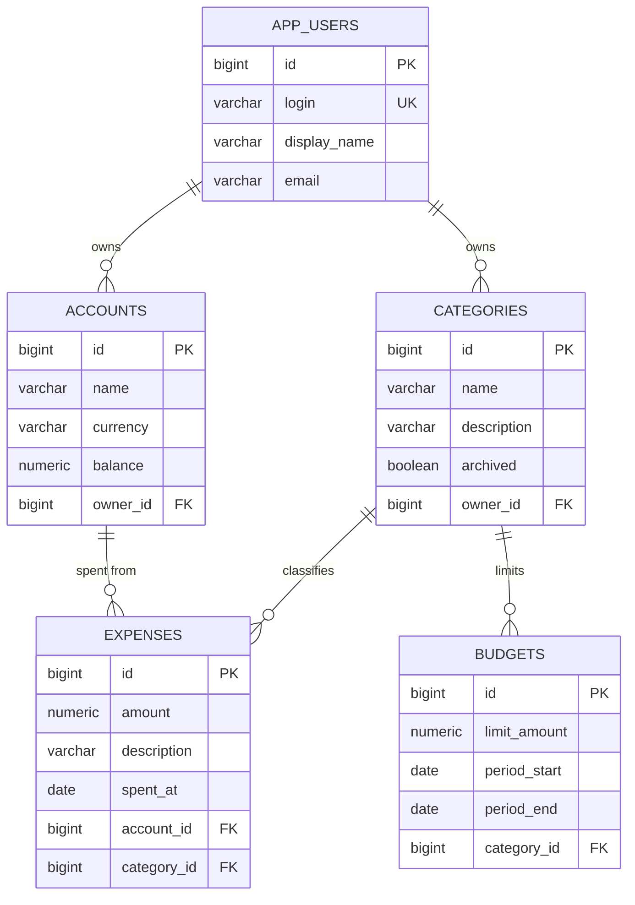

# Учёт и анализ личных расходов

Spring Boot приложение. Java 21, Maven 3.6.3+.

## Практическая работа 4: БД, Hibernate, Spring Data

Данные расходов хранятся в PostgreSQL.

### Запуск

1. Установите PostgreSQL и создайте базу: `CREATE DATABASE data_analysis;`
2. При необходимости задайте переменные `DB_URL`, `DB_USER`, `DB_PASSWORD`
   (по умолчанию `jdbc:postgresql://localhost:5432/data_analysis`, `postgres` / `postgres`).
3. `mvn spring-boot:run` — таблицы создаются автоматически (`ddl-auto=update`).
4. `mvn test` — тесты используют встроенную H2 в режиме PostgreSQL, запущенная СУБД не нужна.

### ER-диаграмма

### Структура кода (`ru.student.dataanalysis.expense`)

- `entity` — сущности `AppUser`, `Account`, `Category`, `Expense`, `Budget`.
- `repository` — `CrudRepository` для каждой сущности. В `ExpenseRepository`:
  `findBySpentAtBetweenAndAmountGreaterThanEqual` (Query Lookup Strategies, `Between` + `And`) и
  `findByCategoryName` (JPQL через `@Query`, поиск по связанной сущности).
- `dao` — `ExpenseCriteriaRepository` и `ExpenseCriteriaRepositoryImpl`: те же два запроса на Criteria API.
- `service` — `ExpenseTrackingService.registerExpense`: запись траты и списание со счёта в одной транзакции
  (`PlatformTransactionManager`); при нехватке средств всё откатывается.
- Тесты: `src/test/java/.../expense` (положительные кейсы и откат транзакции).

## Практическая работа 5: Spring Web, REST API

Запуск: `mvn spring-boot:run`, порт 8080.

| Что | Адрес |
|---|---|
| Репозитории через Spring Data REST | `/users`, `/accounts`, `/categories`, `/expenses`, `/budgets` |
| Поиск Spring Data REST | `/expenses/search/findByCategoryName?categoryName=Еда` |
| Свои REST-методы (репозиторий) | `/custom/expenses/findByPeriodAndMinAmount?from=2031-03-01&to=2031-03-31&minAmount=100`, `/custom/expenses/findByCategoryName?categoryName=Еда` |
| Те же методы на Criteria API | `/custom/expenses/criteria/findByPeriodAndMinAmount`, `/custom/expenses/criteria/findByCategoryName` |
| Трата по id (404, если нет) | `/custom/expenses/{id}` |
| HTML-страница со списком трат | `/custom/expenses/view/list` |
| Swagger UI | `/swagger-ui/index.html` (спецификация: `/v3/api-docs`) |

Ошибки обрабатывает `ExceptionControllerAdvice` и всегда отвечает JSON `{"message": "..."}`
со статусом 400, 404, 405 или 500.

Код: `expense/controller` (REST и HTML), `expense/exception` (обработка ошибок),
шаблон `src/main/resources/templates/expenseList.html`, тесты `RestApiTest`.

Версия springdoc 2.8.9 вместо 2.6.0 из методички: 2.6.0 не рассчитана на Spring Boot 3.5.
## Actuator

После запуска доступны:

- `http://localhost:8080/actuator/health`
- `http://localhost:8080/actuator/info`
- `http://localhost:8080/actuator/metrics`
- `http://localhost:8080/actuator/metrics/jvm.info`
