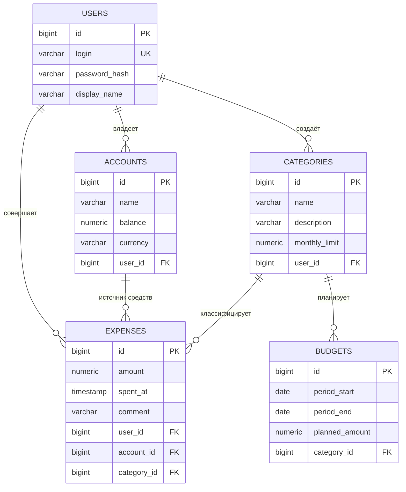

# ER-диаграмма БД «Учёт и анализ личных расходов»

## Сущности

| Сущность | Логические атрибуты | Связи |
|---|---|---|
| **User** (пользователь) | login, password_hash, display_name | 1 → N Account, Category, Expense |
| **Account** (счёт/кошелёк) | name, balance, currency | N → 1 User; 1 → N Expense |
| **Category** (категория расходов) | name, description, monthly_limit | N → 1 User; 1 → N Expense, Budget |
| **Expense** (трата) | amount, spent_at, comment | N → 1 User, Account, Category |
| **Budget** (плановый бюджет) | period_start, period_end, planned_amount | N → 1 Category |

У каждой сущности не менее 3 логических атрибутов (без учёта первичных и внешних ключей) и хотя бы одна связь с другой сущностью.
